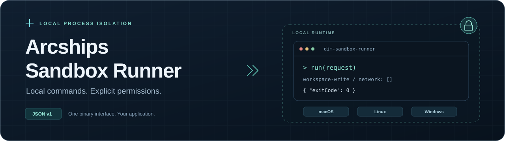
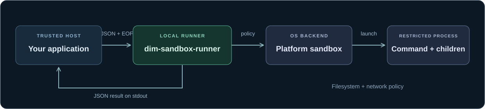

<p align="center">
  
</p>

<p align="center">
  <a href="https://github.com/arcships/sandbox/actions/workflows/native-runner.yml"></a>
  <a href="https://github.com/arcships/sandbox/releases/tag/v0.1.5"></a>
  <a href="docs/protocol.md"></a>
  <a href="LICENSE"></a>
</p>

<p align="center">
  <strong>Native local execution. Filesystem and network policies. A small JSON interface.</strong>
</p>

<p align="center">
  <a href="#quick-start">Quick start</a> &nbsp; · &nbsp;
  <a href="docs/usage.md">中文接入指南</a> &nbsp; · &nbsp;
  <a href="docs/protocol.md">Protocol</a> &nbsp; · &nbsp;
  <a href="https://github.com/arcships/sandbox/releases">Downloads</a>
</p>

---

`dim-sandbox-runner` runs commands on your machine under platform-specific filesystem and network restrictions. Send a JSON request over stdin; receive a JSON result on stdout.

| Native execution | Explicit permissions | Language independent |
| :--- | :--- | :--- |
| macOS Seatbelt, Linux bubblewrap + seccomp, and Windows restricted token. | Choose readable and writable roots, deny paths, and allowed domains. | Invoke the standalone binary from any application that can start a process. |

The binary runs independently of Dim Agent or Codex CLI. Node.js is used by the examples and verification scripts; Rust is needed when building from source. See [platform limitations](docs/protocol.md#platform-and-runtime-limitations) for differences in enforcement.

## Quick Start

**1. Get the payload.** Download the matching archive from [Releases](https://github.com/arcships/sandbox/releases/tag/v0.1.5), verify its checksum, and extract it. Preserve the complete `<platform>/runtime/sandbox/` directory. [Download instructions →](docs/usage.md#1-获取-runner)

**2. Run a command.** From a checkout of this repository, with Node.js 20+ installed:

```bash
mkdir -p demo-workspace

# macOS Apple Silicon; substitute your extracted platform path.
node examples/run-command.mjs \
  ./darwin-arm64/runtime/sandbox/dim-sandbox-runner \
  ./demo-workspace \
  /bin/sh -c 'printf sandbox-ok > result.txt'
```

**3. Inspect the result.** An `exitCode` of `0` and `demo-workspace/result.txt` containing `sandbox-ok` confirm this command completed. The example requests workspace writes, `.env` read denials, and blocked network access.

The [dependency-free example](examples/run-command.mjs) handles stdin EOF, response validation, exit-code propagation, and a host watchdog. For Windows commands, raw JSON requests, and actual isolation checks, follow the [usage guide](docs/usage.md#2-执行第一个隔离命令).

## Published Platforms

| Platform | Release payloads | Backend | Deployment note |
| :--- | :--- | :--- | :--- |
| **macOS** | `darwin-arm64` · `darwin-x64` | Seatbelt | Filesystem restrictions and managed network proxy |
| **Linux** | `linux-arm64` · `linux-x64` | bubblewrap + seccomp | GNU Linux builds; requires usable user namespaces |
| **Windows** | `windows-x64` | Restricted token | Legacy conversion does not preserve read restrictions |

Five platform payloads are published in **v0.1.5**. WSL2 uses the Linux backend; WSL1 lacks the required namespaces. Windows ARM64 has a build target mapping but no published payload.

> [!IMPORTANT]
> Isolation guarantees vary by platform. Windows read restrictions and its file-mode-off network path have limitations. Host applications also own timeouts and resource controls. Read the [current implementation boundaries](docs/protocol.md#platform-and-runtime-limitations) before deployment.

## How It Works

<p align="center">
  
</p>

The application chooses a trusted policy; the runner maps it to pinned native sandbox components. Only commands launched through the runner receive its restrictions. Direct file/network calls in your application need their own permission checks, and allowed writes modify real local files.

[Process boundaries and request sequence →](docs/usage.md#4-接入后的进程与权限范围)

## Documentation

| Start here | What you will find |
| :--- | :--- |
| [使用与接入指南（中文）](docs/usage.md) | Download, runnable examples, permission settings, and integration diagrams |
| [JSON protocol v1](docs/protocol.md) | Request/response fields, failure handling, and platform limitations |
| [Native development](native/README.md) | Build prerequisites, target selection, and verification commands |
| [Standalone Node.js example](examples/run-command.mjs) | A small process-protocol client using only Node.js standard libraries |

## Development

<details>
<summary><strong>Build and verify from source</strong></summary>

Install Git, Node.js 20+, Rust/Cargo, pnpm, and your platform's native build tools. Linux also needs bubblewrap. See [platform prerequisites](native/README.md#prerequisites).

```bash
git clone --recurse-submodules https://github.com/arcships/sandbox.git
cd sandbox

node native/scripts/patch-codex-submodule.mjs
pnpm native:check
pnpm native:build
pnpm native:protocol
pnpm native:smoke
```

Build on the target operating system. The staged payload is written to `native/target/release/`. See the [native guide](native/README.md) for architecture selection and platform test coverage. Build outputs do not imply code signing or notarization.

</details>

<details>
<summary><strong>Explore the repository</strong></summary>

```text
docs/                     Usage, protocol, and diagrams
examples/                 Standalone process client
native/runner/            Rust runner and policy mapping
native/scripts/           Builds and smoke checks
third_party/openai-codex  Pinned platform components
```

This repository owns the native runner, protocol, policy mapping, and release artifacts. Application SDKs, Agent tool adapters, and approval UI belong to the consuming application.

</details>

## Artifact Contract

Keep the complete payload together when packaging it with your application:

```text
<platform>/runtime/sandbox/
├── dim-sandbox-runner[.exe]
├── codex-linux-sandbox              # Linux
├── codex-resources/bwrap            # Linux
├── codex-command-runner.exe         # Windows
└── codex-windows-sandbox-setup.exe   # Windows
```

macOS/Linux archives use `.tar.gz`; Windows uses `.zip`. Platform helpers must retain these relative paths. Releases include archive checksums in `SHA256SUMS`.

---

Licensed under [Apache 2.0](LICENSE). Native sandbox components come from [OpenAI Codex](https://github.com/openai/codex), pinned as a submodule. See [upstream attribution](native/NOTICE.md).
