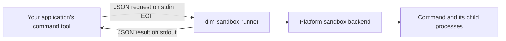

# Arcships Sandbox Runner

`dim-sandbox-runner` executes a command on the local machine with filesystem and network permissions enforced by a platform backend. It uses pinned components from the `third_party/openai-codex` submodule.

Any application can invoke the standalone binary using the [JSON protocol](docs/protocol.md). Running it does not require Dim Agent, Codex CLI, Node.js, or Rust. Node.js is needed for this repository's examples and verification scripts; Rust is needed to build from source.

This repository owns the native runner, policy mapping, build scripts, and release artifacts. Application SDKs, Agent tool adapters, and approval UI belong to the consuming application.

- [使用与接入指南（中文）](docs/usage.md): download, runnable examples, integration diagrams, and isolation boundaries.
- [Protocol reference](docs/protocol.md): request fields, permissions, results, and current limitations.
- [Native development](native/README.md): source builds and platform verification.

## How It Fits Into an Application



Only commands launched through the runner receive its restrictions. The application chooses the policy and handles its own direct file/network tools. Allowed writes modify real local files.

## Published Platforms

| Release platform | Architecture | Backend | Important boundary |
| --- | --- | --- | --- |
| `darwin-arm64` | Apple Silicon | macOS Seatbelt | Filesystem restrictions and managed network proxy |
| `darwin-x64` | Intel | macOS Seatbelt | Same backend as ARM64 |
| `linux-arm64` | ARM64 | bubblewrap + seccomp | Requires usable user namespaces; GNU Linux build |
| `linux-x64` | x86-64 | bubblewrap + seccomp | Same backend as ARM64 |
| `windows-x64` | x86-64 | Windows restricted token | Read restrictions are not preserved by the legacy policy conversion |

These five payloads are published in [v0.1.5](https://github.com/arcships/sandbox/releases/tag/v0.1.5). Windows ARM64 has a build target mapping but no published payload. WSL2 uses the Linux backend; WSL1 cannot provide its required namespaces. See [platform limitations](docs/protocol.md#platform-and-runtime-limitations) before selecting policies.

## Quick Start

Download and extract the matching release archive. Preserve the complete `<platform>/runtime/sandbox/` directory, including platform helpers. See the [download instructions](docs/usage.md#1-获取-runner).

The dependency-free Node.js example creates a protocol request, closes stdin, reads the result, and propagates the command's exit code. From a checkout of this repository, on macOS/Linux:

```bash
mkdir -p demo-workspace
node examples/run-command.mjs ./darwin-arm64/runtime/sandbox/dim-sandbox-runner ./demo-workspace /bin/sh -c 'printf sandbox-ok > result.txt'
```

Use your extracted platform path. This example enables `workspace-write`, blocks network access, and explicitly denies `.env` reads. It accepts the command as an argv array. Windows invocation and raw JSON usage are in the [usage guide](docs/usage.md#2-执行第一个隔离命令).

## Layout

```text
docs/                     # standalone usage and protocol reference
examples/                 # standalone Node.js protocol client
native/
  Cargo.toml
  runner/                 # dim-sandbox-runner
  scripts/                # build and smoke verification scripts
third_party/openai-codex  # pinned git submodule
```

## Build From Source

Install Git, Node.js 20+, Rust/Cargo, and your platform's native build tools. Linux also needs bubblewrap. See [platform prerequisites](native/README.md#prerequisites).

```bash
git clone https://github.com/arcships/sandbox.git
cd sandbox
git submodule update --init --recursive
node native/scripts/patch-codex-submodule.mjs
pnpm native:check
pnpm native:build
pnpm native:protocol
pnpm native:smoke
```

The build script is intentionally OS-native:

- macOS builds macOS payloads.
- Linux builds Linux payloads.
- Windows builds Windows payloads.

The staged payload is written to `native/target/release/`. Build outputs do not imply code signing or notarization.

## Artifact Contract

Release archives contain a platform directory such as `darwin-arm64/`, with the complete runtime payload beneath it:

```text
<platform>/runtime/sandbox/
  dim-sandbox-runner[.exe]
  codex-linux-sandbox              # Linux only
  codex-resources/bwrap            # Linux only
  codex-command-runner.exe         # Windows only
  codex-windows-sandbox-setup.exe  # Windows only
```

Keep helpers beside the runner at these relative paths. macOS/Linux use `.tar.gz` archives; Windows uses `.zip`. Releases also include archive checksums in `SHA256SUMS`.

