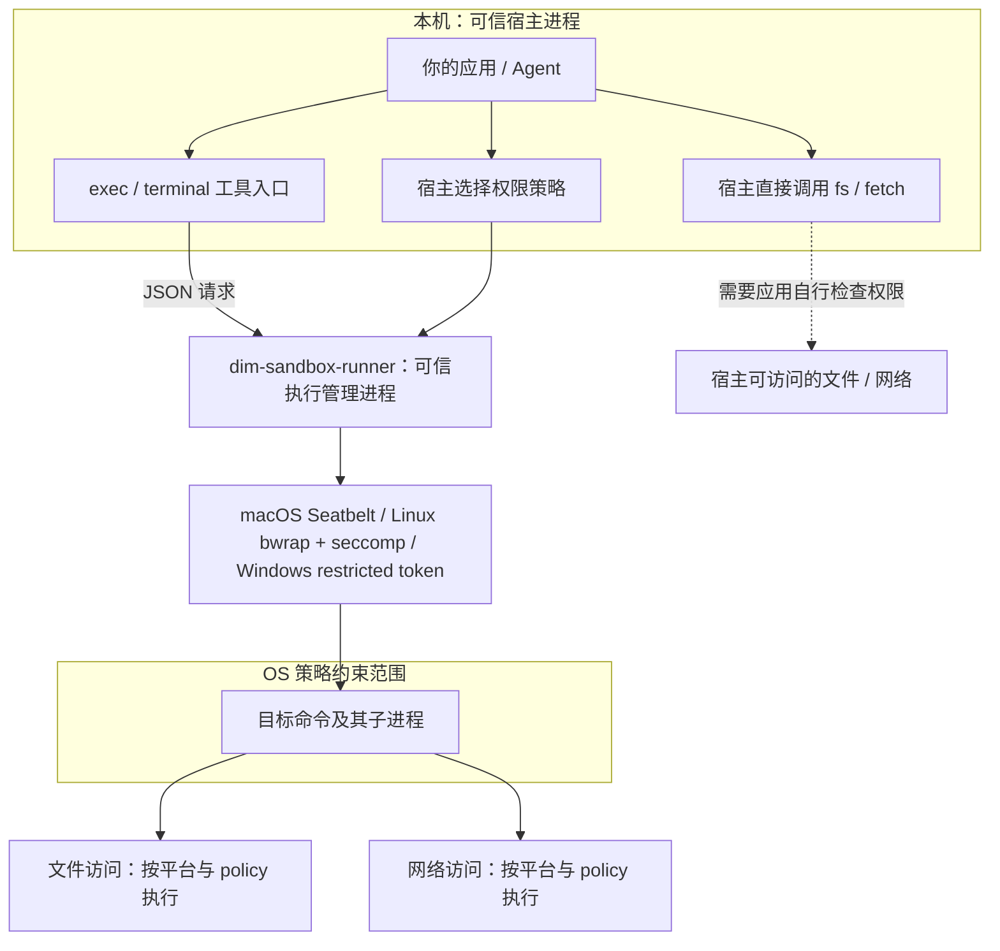
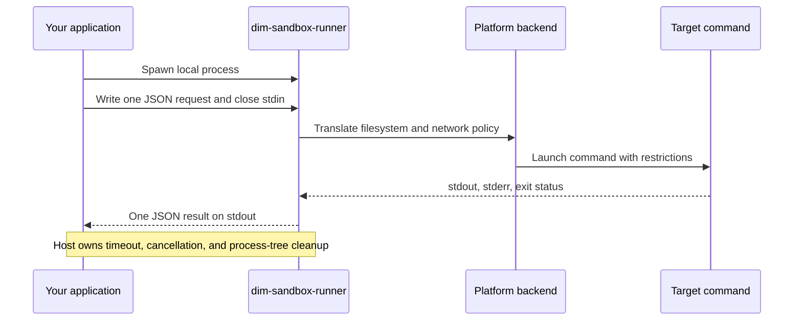

# 独立使用与应用接入

本指南只使用这个仓库提供的二进制、协议和示例。你的应用负责选择权限、启动 runner、读取结果；runner 负责把策略交给本机操作系统并执行命令。平台与架构列表见 [README](../README.md#published-platforms)，字段与实现边界见 [协议参考](protocol.md)。

## 1. 获取 runner

### 使用发布包

从 [v0.1.5 Release](https://github.com/arcships/sandbox/releases/tag/v0.1.5) 下载与你的操作系统和 CPU 架构一致的压缩包。以下以 macOS Apple Silicon 为例，在仓库根目录执行：

```bash
curl -fLO https://github.com/arcships/sandbox/releases/download/v0.1.5/dim-sandbox-runner-darwin-arm64.tar.gz
shasum -a 256 dim-sandbox-runner-darwin-arm64.tar.gz
tar -xzf dim-sandbox-runner-darwin-arm64.tar.gz
```

先将摘要与 Release 页或 `SHA256SUMS` 中对应文件的摘要核对，再执行下载的程序。Linux 可用 `sha256sum` 计算摘要。`SHA256SUMS` 中记录的是 CI 目录路径，平铺下载后应按压缩包文件名匹配摘要，不能直接照搬其中的路径。

解压后的入口是 `darwin-arm64/runtime/sandbox/dim-sandbox-runner`。其他包将 `darwin-arm64` 换成对应的发布平台名。Windows 下载 `.zip` 并解压，入口是 `windows-x64/runtime/sandbox/dim-sandbox-runner.exe`。

保留完整的 `runtime/sandbox/` 目录：Linux 的 helper 和 `codex-resources/bwrap`、Windows 的两个 helper 都属于运行时的一部分。Linux 包基于 GNU target 构建，宿主系统仍需满足动态库依赖，并允许创建 user namespace。

### 从源码构建

按 [native 构建说明](../native/README.md) 安装工具、初始化 submodule 后执行：

```bash
node native/scripts/patch-codex-submodule.mjs
pnpm native:check
pnpm native:build
```

构建入口是 `native/target/release/dim-sandbox-runner`，Windows 为 `.exe`。后面的命令可以将发布包路径换成这个本地构建路径。

## 2. 执行第一个隔离命令

仓库附带 [examples/run-command.mjs](../examples/run-command.mjs)，仅使用 Node.js 20+ 标准库，无需安装 npm 依赖。在仓库根目录运行：

```bash
mkdir -p demo-workspace
node examples/run-command.mjs ./darwin-arm64/runtime/sandbox/dim-sandbox-runner ./demo-workspace /bin/sh -c 'printf sandbox-ok > result.txt'
```

示例输出 JSON 结果。预期 `exitCode` 为 `0`，`demo-workspace/result.txt` 内容为 `sandbox-ok`。示例请求 `workspace-write`，根目录只配置工作区，设置 `.env` 和 `.env.*` 拒读规则，并请求禁止联网。macOS/Linux 按相应后端执行这些限制；Windows 不保留同等级的读隔离，不能依赖这些规则保护秘密文件。示例不会自动读取应用配置，也不依赖其他仓库的 adapter。

Windows PowerShell 示例：

```powershell
New-Item -ItemType Directory -Force demo-workspace | Out-Null
node examples/run-command.mjs .\windows-x64\runtime\sandbox\dim-sandbox-runner.exe .\demo-workspace $env:ComSpec /d /s /c "echo sandbox-ok>result.txt"
```

`command` 是程序和参数的数组。需要重定向、管道等 shell 语法时，像示例一样显式调用 `/bin/sh -c` 或 `cmd.exe /c`。目标命令必须能读取其可执行文件及依赖；自定义安装的 Node/Python 等工具链可能需要额外配置 `readableRoots`。

## 3. 用原始 JSON 调用

任意语言都可以实现同一协议。下面以 macOS/Linux 为例，把 `/absolute/path/demo-workspace` 换成已经创建的工作区绝对路径，将内容保存为 `request.json`：

```json
{
  "version": 1,
  "requestId": "example-1",
  "command": ["/bin/sh", "-c", "printf sandbox-ok > result.txt"],
  "cwd": "/absolute/path/demo-workspace",
  "env": { "PATH": "/usr/bin:/bin" },
  "policy": {
    "enabled": true,
    "mode": "workspace-write",
    "workspaceRoot": "/absolute/path/demo-workspace",
    "readableRoots": ["/absolute/path/demo-workspace"],
    "writableRoots": ["/absolute/path/demo-workspace"],
    "readDenyPaths": ["**/.env", "**/.env.*"],
    "allowedDomains": []
  }
}
```

```bash
./darwin-arm64/runtime/sandbox/dim-sandbox-runner run < request.json > result.json
```

runner 读取 stdin 直到 EOF，然后执行一次命令并输出一个 JSON 结果。应用通过管道调用时，必须在写完请求后关闭 stdin；只写入换行符还不足以开始执行。每次请求启动一个 runner 进程。

runner 进程退出 `0` 表示成功产生结果；命令是否成功要继续检查 JSON 中的 `exitCode`、`signal`。请求解析、策略转换或启动失败时，runner 向 stderr 写错误并退出 `1`，此时可能没有 JSON 结果。完整字段见 [协议参考](protocol.md#request)。

## 4. 接入后的进程与权限范围



runner、代理和你的应用属于可信宿主。被施加 OS 限制的是目标命令及其子进程。允许的写入会直接修改本地文件；工作区里的恶意程序也不能自行决定扩大权限。

应用接入需要覆盖两个入口：所有命令执行统一经过 runner；宿主直接实现的文件读写、HTTP 请求等工具单独检查相同的权限策略。把命令工具换成 runner，不会自动约束应用进程中的其他代码。

### 一次调用的时序



策略或启动失败走 runner stderr 和非零退出状态，不会执行到正常结果步骤。目标命令中的权限拒绝通常表现为命令非零 `exitCode` 和命令 stderr，应据此反馈给用户。

## 5. 配置权限

| 目的 | 配置 |
| --- | --- |
| 只读工作区 | `enabled: true`，`mode: "read-only"` |
| 读写工作区 | `enabled: true`，`mode: "workspace-write"` |
| 增加只读工具链目录 | 在 `readableRoots` 中保留工作区并增加必要目录 |
| 增加可写目录 | 显式加入 `writableRoots`，同时保留需要写入的工作区 |
| 禁止联网 | `allowedDomains: []` |
| 域名白名单 | `allowedDomains: ["example.com"]` |
| 网络全开 | `allowedDomains: ["*"]` |

这些是请求的策略；各平台的实际保证见 [平台限制](protocol.md#platform-and-runtime-limitations)，尤其是 Windows 的读隔离和文件模式 `off` 时的网络处理。`off` / `danger-full-access` 放开文件访问；`enabled: false` 会绕过文件与网络限制。

runner 不内置 `.env`、SSH 凭据等默认拒读名单。示例中的拒读规则是示例主动传入的。应用应明确构造路径列表和目标命令的环境变量，避免把所有宿主凭据复制进请求。不要让不可信命令或模型自行设置 `enabled`、根目录或网络白名单。

## 6. 验证接入

先验证协议，再验证真实隔离。在仓库根目录执行，最后一个参数可换为解压后的 runner 路径：

```bash
node native/scripts/protocol-compat.mjs ./native/target/release/dim-sandbox-runner
node native/scripts/smoke-platform.mjs ./native/target/release/dim-sandbox-runner
```

协议检查验证 v1 请求及未知版本拒绝，运行时关闭了隔离。平台 smoke 会检查工作区读写、越界写入、只读模式和网络策略，需要 `curl`，且允许联网的测试需要能访问 `example.com`、`www.iana.org`。Windows 换用 `.exe` 路径。

macOS 本地构建还可以执行 `pnpm native:smoke:macos`。Linux 部署验证应保持默认严格模式；CI 的 `--allow-host-sandbox-unavailable` 允许在指定 namespace 初始化失败时通过，不适合作为机器隔离可用的证明。Windows 测试不要求外部文件读取被阻止。

## 7. 宿主需要处理的生命周期

宿主负责超时、取消、进程树回收、并发和输出大小限制。当前 macOS/Linux runner 不执行请求里的 `timeoutMs`，结果中的 `timedOut` 固定为 `false`。仅杀死 runner 可能留下目标进程，应按操作系统管理整棵进程树。

示例附带 30 秒宿主 watchdog，说明如何对进程树发起终止；它是可读的接入样例，生产应用仍需按自己的生命周期和资源需求完善控制。当前 runner 在内存中缓冲目标命令输出，执行结束后一次性返回，不能依靠实时 stdout 消息展示执行进度，也没有 CPU/内存配额接口。
